 

### About

I take ideas from a circuit or a database schema all the way to a working product. I'm an ECE student who builds full-stack apps, prototypes with microcontrollers and integrates AI into real applications, and I'm working toward becoming an entrepreneur who ships useful technology.

### What I work on

| Software | Hardware | AI |
| :-- | :-- | :-- |
| Java, Spring Boot | Arduino, ESP32 | AI API integration |
| Next.js, TypeScript | Embedded systems | RAG applications |
| Python, PostgreSQL | Sensors and IoT | AI-powered applications |
| Git, GitHub, VS Code | Electronics prototyping | Intelligent automation |

### Featured project

**ThiranX: career and coding progress tracker.** A full-stack platform where learners plan roadmaps, track progress and get AI guidance in one place.

- Roadmaps with AI-generated tasks
- LeetCode and GitHub progress integration
- AI coach for guidance and insights
- Calendar and to-do planning

`Next.js` `React` `TypeScript` `Tailwind CSS` `Supabase` `Google Gemini`

<!-- Add CleanSei here in the same format once you have the details and the repo link. -->

  

**Open to internships and collaborations in software development, full-stack and AI-enabled applications.**

